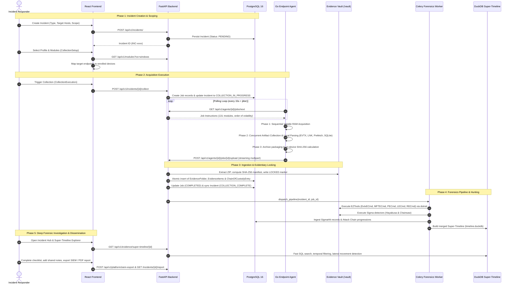
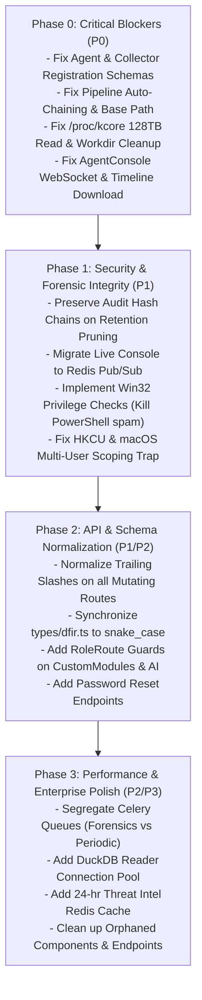

# Comprehensive Technical Audit & Code Review: DFIR Rapid Collection Kit

**Date**: 2026-11-09  
**Review Team**: Multi-Subagent Specialized Audit Taskforce (Frontend Architecture, Backend & Database Architecture, API Integration & Contracts, Go Systems & DFIR Agent)  
**Target Repository**: `DFIRCollectionKit` (Go 1.25, FastAPI, React 18, PostgreSQL 16, Celery, DuckDB)

---

## 1. Executive Summary & Health Scorecard

A thorough, multi-agent code audit was executed across the entire DFIR Rapid Collection Kit codebase, covering 34 frontend pages and components, 149 backend FastAPI routes across 21 routers, 20 Alembic migrations, Celery forensics pipeline workers, and 131 Go collection modules with local binary parsers.

### Overall System Health Scorecard

| Subsystem | Health Grade | Strengths | Critical Gaps |
| :--- | :---: | :--- | :--- |
| **Go Agent** (`agent/`) | **B+** | 100% module sync (131/131), clean zero-installer portability, memory-safe streaming uploads, native Win32 backup privilege. | Linux `/proc/kcore` 128TB crash risk; endpoint workdir not deleted on success; workdir wiped on transient network failure. |
| **Backend API & Services** (`backend/app/`) | **B** | Solid asyncpg SQLAlchemy 2.0 design, RFC 3227 evidentiary locking, DuckDB vectorized super-timeline engine, robust Sigma integrations. | Fatal import crash in pipeline auto-chaining; DuckDB timeline base path mismatch; broken scheduled integrity check; in-memory command console. |
| **Frontend SPA** (`frontend/src/`) | **A-** | Immersive tactical HUD aesthetic, high query hygiene with TanStack Query v5, full 34-page coverage across entire DFIR lifecycle. | WebSocket missing token in `AgentConsole.tsx`; reload state loss in `CollectionExecution.tsx`; global `EvidenceContext` pollution across incidents. |
| **API Integration & Contracts** | **C+** | Strict security headers, HttpOnly session cookie auth, structured Pydantic schemas. | **5 Runtime Showstoppers**: Agent enrollment fails with 422; Collector creation fails with 422; SIEM settings 404; Timeline download crash; User password reset silently ignored. |

---

## 2. End-to-End Application Workflow Analysis

The application implements a forensic incident response workflow divided into 8 distinct lifecycle phases:

### Detailed Workflow Step Breakdown

1. **Incident Intake & Scoping (`CreateIncident.tsx` -> `CollectionSetup.tsx`)**:
   - Operator initiates case with metadata (type, priority, severity, targets) or inherits from pre-configured `IncidentTemplates`.
   - The UI auto-queries enrolled endpoints (`GET /api/v1/devices/`) to match target hostnames, detect OS architectures, and surface relevant collection modules.
2. **Collection Dispatch & Execution (`CollectionExecution.tsx`)**:
   - The UI submits selected module IDs and profile settings to `POST /api/v1/incidents/{id}/collect`.
   - Backend transitions incident to `COLLECTION_IN_PROGRESS`, initializes database `Job` rows, and appends a `ChainOfCustodyEntry`.
   - Distributed Go agents poll `GET /api/v1/agents/{id}/jobs/next`, unpack job instructions, and enforce RFC 3227 Order of Volatility: volatile memory first, followed by concurrent artifact gathering bounded by a 4-worker semaphore.
3. **Evidence Ingestion & Cryptographic Locking (`agents.py` -> `evidence_files.py`)**:
   - Agent streams `collection.zip` via HTTP multipart without memory buffering.
   - Backend writes upload directly to `{evidence_root}/{incident_id}/{job_id}/collection.zip`, extracts members under decompression bomb limits (50 GB cap), and computes a SHA-256 hash manifest.
   - An immutable `LOCKED` marker is written to disk, and the folder is sealed. Any subsequent attempt to overwrite locked evidence is rejected with `HTTP 409 Conflict`.
4. **Celery Forensics Pipeline (`artifact_parser_service.py` -> `worker.py`)**:
   - If `auto_process` is enabled, backend dispatches Celery task `dfir.run_pipeline`.
   - **Phase 1 (EZTools)**: Runs 9 Zimmerman tools in isolated output folders with coverage tracking.
   - **Phase 2 (Sigma Hunting)**: Runs Hayabusa and Chainsaw against extracted EVTX records, recording normalized `SigmaHit` entries.
   - **Phase 3 (Super-Timeline)**: Normalizes parsed CSVs and JSONL logs into DuckDB columnar database with indexes on `event_dt`, `host`, and `source_short`.
   - **Phase 4 (Threat Analytics)**: Computes lateral movement graphs, account pivots, beaconing candidates, and MITRE ATT&CK kill chain progressions.
5. **Investigation, Threat Hunting & Reporting (`IncidentHub.tsx`)**:
   - Central command center displays 4-step progress, threat detections, and quick module navigation.
   - Analysts explore timelines in `SuperTimeline.tsx`, review detections in `SigmaHits.tsx`, inspect attack paths in `AttackChains.tsx`, and correlate IOCs with VirusTotal/MISP in `ThreatIntel.tsx`.
   - Final deliverables are produced via printable report (`IncidentReport.tsx`), tamper-evident chain of custody export (`ChainOfCustody.tsx`), or SIEM export (`SIEMExport.tsx`).

---

## 3. Critical Runtime Breakages (P0 - Immediate Action Required)

The audit discovered **8 critical defects** that immediately cause runtime crashes, failed agent enrolments, or complete background pipeline stalls:

### 1. Go Agent Registration Rejected with HTTP 422
* **Files**: [backend/app/schemas/device.py#L20-L21](file:///d:/0x13%20PROJECT/DFIRCollectionKit/backend/app/schemas/device.py#L20-L21), [agent/internal/api/client.go#L246](file:///d:/0x13%20PROJECT/DFIRCollectionKit/agent/internal/api/client.go#L246)
* **Defect**: `DeviceCreate` inherits from `DeviceBase` where `last_seen`, `collection_status`, and `registered_at` are required fields with no defaults. The Go agent does not send these backend-managed timestamp fields.
* **Impact**: Every agent registration fails with HTTP 422 Unprocessable Entity. **No new agent can enroll with the server.**
* **Remediation**: Provide `default_factory=lambda: datetime.now(timezone.utc)` for `last_seen` and `registered_at`, and default `"IDLE"` for `collection_status` in `DeviceCreate`.

### 2. Collector Creation Form Rejected with HTTP 422
* **Files**: [backend/app/schemas/collector.py#L13-L14](file:///d:/0x13%20PROJECT/DFIRCollectionKit/backend/app/schemas/collector.py#L13-L14), [frontend/src/pages/Collectors.tsx#L143](file:///d:/0x13%20PROJECT/DFIRCollectionKit/frontend/src/pages/Collectors.tsx#L143)
* **Defect**: `CollectorCreate` requires `id`, `status`, and `last_heartbeat` with no defaults. The frontend modal sends only `{ name, endpoint }`.
* **Impact**: Analysts cannot add new collector nodes from the UI.
* **Remediation**: Add default factories for `id` (`COL-{uuid}`), `status` (`ONLINE`), and `last_heartbeat` (`utcnow`) in `CollectorCreate`.

### 3. Pipeline Chaining Fatal Crash Silently Aborts Super-Timeline
* **Files**: [backend/app/services/artifact_parser_service.py#L453, L465](file:///d:/0x13%20PROJECT/DFIRCollectionKit/backend/app/services/artifact_parser_service.py#L453)
* **Defect 1**: Line 453 imports `from app.crud.system_settings import get_runtime_settings`. The module `app.crud.system_settings` does not exist; it is located at `app.services.system_settings_service`.
* **Defect 2**: Line 465 passes `base_path` (`{storage}/{inc}/{job}`) to `dispatch_super_timeline()`. However, `super_timeline_service.py:370` expects `evidence_base_path` to be root `{storage}`.
* **Impact**: Caught by generic `except Exception`, this silently aborts automatic Super-Timeline generation on 100% of completed collections. DuckDB timelines are never created automatically.
* **Remediation**: Fix the import path and pass `Path(runtime.evidence_storage_path)`.

### 4. Evidence Integrity Check Silently Skips 100% of Files
* **Files**: [backend/app/worker.py#L580](file:///d:/0x13%20PROJECT/DFIRCollectionKit/backend/app/worker.py#L580)
* **Defect**: `verify_evidence_integrity_task` checks `file_path = evidence_base / item.incident_id / item.name`. Extracted artifacts actually live at `item.relative_path` (`{job_id}/extracted/...`).
* **Impact**: `file_path.exists()` is always `False`. The background task silently skips all evidence items. Evidentiary integrity verification has 0% coverage.
* **Remediation**: Resolve `file_path` using `item.relative_path`.

### 5. Unbounded Linux Kernel Virtual Memory Read (/proc/kcore 128TB Crash)
* **Files**: [agent/internal/modules/linux_memory.go#L61-L80](file:///d:/0x13%20PROJECT/DFIRCollectionKit/agent/internal/modules/linux_memory.go#L61-L80)
* **Defect**: When AVML is not present, `linux_memory_acquisition` falls back to `io.Copy(dst, src)` directly on `/proc/kcore`. On 64-bit Linux kernels, `/proc/kcore` presents an apparent virtual memory size of 128 Terabytes.
* **Impact**: `io.Copy` attempts to write 128 TB until target host disk space is 100% full, crashing database and system processes on the endpoint under investigation.
* **Remediation**: Parse ELF `PT_LOAD` segments for physical RAM ranges or clamp read bytes to `MemTotal` from `/proc/meminfo`.

### 6. Endpoint Workdir Retention & Premature Wipe Hazards
* **Files**: [agent/internal/jobs/executor.go#L135-L142, L403](file:///d:/0x13%20PROJECT/DFIRCollectionKit/agent/internal/jobs/executor.go#L135-L142)
* **Defect 1**: `storage.Cleanup(workDir)` is deferred only when `retErr != nil`. On successful upload, cleanup is **never called**, leaving multi-gigabyte forensic ZIPs permanently on target endpoints.
* **Defect 2**: If an upload fails due to a transient network timeout on a slow WAN, `retErr != nil` fires and immediately deletes the entire `workDir`, destroying hours of collected volatile evidence.
* **Remediation**: Clean up workdir after verified upload; add exponential backoff retry to `UploadEvidence` and retain local archives if all retries fail.

### 7. WebSocket Handshake & Localhost Bug in Agent Console
* **Files**: [frontend/src/pages/AgentConsole.tsx#L20-L25, L59](file:///d:/0x13%20PROJECT/DFIRCollectionKit/frontend/src/pages/AgentConsole.tsx#L20-L25), [backend/app/api/v1/endpoints/agent_commands.py#L127](file:///d:/0x13%20PROJECT/DFIRCollectionKit/backend/app/api/v1/endpoints/agent_commands.py#L127)
* **Defect**: Backend WebSocket endpoint requires `token: str = Query(...)`. Frontend passes no token query parameter. Frontend also hardcodes `window.location.host` instead of respecting `VITE_API_BASE_URL`.
* **Impact**: Live agent web console fails to connect in production environments.
* **Remediation**: Append active session token as query parameter and derive WebSocket URL from `VITE_API_BASE_URL`.

### 8. Timeline Download JSON Parsing / TypeError Crash
* **Files**: [frontend/src/pages/ProcessingStatus.tsx#L496-L497](file:///d:/0x13%20PROJECT/DFIRCollectionKit/frontend/src/pages/ProcessingStatus.tsx#L496-L497), [frontend/src/lib/api.ts#L97](file:///d:/0x13%20PROJECT/DFIRCollectionKit/frontend/src/lib/api.ts#L97)
* **Defect**: `ProcessingStatus.tsx` calls `apiGet<Blob>(.../timeline/download)`. However, `apiGet` unconditionally runs `response.json()`.
* **Impact**: Fails with JSON syntax error on streaming NDJSON lines, followed by a `TypeError` on `window.URL.createObjectURL(blob)`. Timeline download button is completely broken.
* **Remediation**: Use raw `fetch` and `.blob()` for binary/stream downloads.

---

## 4. Subsystem-by-Subsystem Gap Analysis

### 4.1 Frontend UI & UX Gaps

| Finding ID | Page / Component | Line Ref | Issue Description | Severity |
| :--- | :--- | :--- | :--- | :---: |
| **FE-GAP-01** | `SIEMExport.tsx` | [L46](file:///d:/0x13%20PROJECT/DFIRCollectionKit/frontend/src/pages/SIEMExport.tsx#L46) | Phantom call to `/api/v1/admin/settings` (fails 404). Backend route is `/api/v1/settings`. | **Critical** |
| **FE-GAP-02** | `CollectionExecution.tsx` | [L136-L140](file:///d:/0x13%20PROJECT/DFIRCollectionKit/frontend/src/pages/CollectionExecution.tsx#L136-L140) | Page reload drops `location.state`, causing `module_ids = []` and firing empty collections. | **Critical** |
| **FE-GAP-03** | `EvidenceContext.tsx` | [L27-L40](file:///d:/0x13%20PROJECT/DFIRCollectionKit/frontend/src/context/EvidenceContext.tsx#L27-L40) | Workspace pinned evidence stored in global localStorage key without scoping by incident ID. | **Critical** |
| **FE-GAP-04** | `Collectors.tsx` | [L73-L77](file:///d:/0x13%20PROJECT/DFIRCollectionKit/frontend/src/pages/Collectors.tsx#L73-L77) | Terminal button calls `/agents/{collector.id}/console`. Collectors are not devices; fails with 404. | **Important** |
| **FE-GAP-05** | `App.tsx` | [L165, L171](file:///d:/0x13%20PROJECT/DFIRCollectionKit/frontend/src/App.tsx#L165) | Routes `/admin/custom-modules`, `/ai-analysis`, and `/console` lack `RoleRoute` protection. | **Important** |
| **FE-GAP-06** | `CustomModules.tsx` | [L32](file:///d:/0x13%20PROJECT/DFIRCollectionKit/frontend/src/pages/CustomModules.tsx#L32) | Operators shown edit/delete buttons, but backend requires `admin` (fails with 403 Forbidden). | **Important** |
| **FE-GAP-07** | `ScheduledCollections.tsx` | [L46, L260](file:///d:/0x13%20PROJECT/DFIRCollectionKit/frontend/src/pages/ScheduledCollections.tsx#L46) | Delete button shown to operators; backend requires `admin` (fails with 403 Forbidden). | **Important** |
| **FE-GAP-08** | `Dashboard.tsx` | [L424-L430](file:///d:/0x13%20PROJECT/DFIRCollectionKit/frontend/src/pages/Dashboard.tsx#L424-L430) | Bulk action `PURGE_SECTOR` has no `onClick` handler (dead button). | **Important** |
| **FE-GAP-09** | `AuditLog.tsx` | [L66-L86](file:///d:/0x13%20PROJECT/DFIRCollectionKit/frontend/src/pages/AuditLog.tsx#L66-L86) | CSV export only downloads current 50 items rather than all filtered audit records. | **Important** |
| **FE-GAP-10** | `TimelineExplorer.tsx` | [L1-L202](file:///d:/0x13%20PROJECT/DFIRCollectionKit/frontend/src/components/TimelineExplorer.tsx#L1-L202) | 202-line orphaned legacy component containing duplicate layout wrapper; never imported. | **Minor** |

### 4.2 Backend & Data Integrity Gaps

| Finding ID | Component | Line Ref | Issue Description | Severity |
| :--- | :--- | :--- | :--- | :---: |
| **BE-GAP-01** | `audit_logs.py` | [L56-L59](file:///d:/0x13%20PROJECT/DFIRCollectionKit/backend/app/api/v1/endpoints/audit_logs.py#L56-L59) | Reading audit logs runs automatic retention pruning, deleting old rows and breaking SHA-256 chain. | **Critical** |
| **BE-GAP-02** | `agent_commands.py` | [L54-L57](file:///d:/0x13%20PROJECT/DFIRCollectionKit/backend/app/api/v1/endpoints/agent_commands.py#L54-L57) | Live command state stored in Python dictionaries; fails in multi-worker Uvicorn setups. | **Critical** |
| **BE-GAP-03** | `models/__init__.py` | [L15](file:///d:/0x13%20PROJECT/DFIRCollectionKit/backend/app/models/__init__.py#L15) | 5 platform models omitted from `__all__`; Alembic autogenerate will attempt to drop tables. | **Critical** |
| **BE-GAP-04** | `users.py` / `crud/user.py` | [L35-L44](file:///d:/0x13%20PROJECT/DFIRCollectionKit/backend/app/crud/user.py#L35-L44) | `UserUpdate` schema has no `password` field; password reset from admin UI is silently ignored. | **Critical** |
| **BE-GAP-05** | `agent_commands.py` | [L347](file:///d:/0x13%20PROJECT/DFIRCollectionKit/backend/app/api/v1/endpoints/agent_commands.py#L347) | Pushes `{"type": "done"}` on first chunk received, terminating multi-chunk console outputs early. | **Important** |
| **BE-GAP-06** | `devices.py` | [L1-L120](file:///d:/0x13%20PROJECT/DFIRCollectionKit/backend/app/api/v1/endpoints/devices.py#L1-L120) | Device enrollment, modification, and deletion perform zero audit log recordings. | **Important** |
| **BE-GAP-07** | `evidence.py` | [L228](file:///d:/0x13%20PROJECT/DFIRCollectionKit/backend/app/api/v1/endpoints/evidence.py#L228) | Uses `!=` instead of `hmac.compare_digest()` for export signature verification (timing side-channel). | **Important** |
| **BE-GAP-08** | `worker.py` | [L66-L97](file:///d:/0x13%20PROJECT/DFIRCollectionKit/backend/app/worker.py#L66-L97) | 2-hour forensic parsing tasks share default queue with 60s cron jobs, causing task starvation. | **Important** |
| **BE-GAP-09** | `models/user.py` | [L16-L17](file:///d:/0x13%20PROJECT/DFIRCollectionKit/backend/app/models/user.py#L16-L17) | `User.last_login` and `created_at` stored as `VARCHAR` instead of `TIMESTAMP WITH TIME ZONE`. | **Minor** |

### 4.3 Go Agent Forensic & OPSEC Gaps

| Finding ID | Component | Line Ref | Issue Description | Severity |
| :--- | :--- | :--- | :--- | :---: |
| **AG-GAP-01** | `privilege.go` | [L13-L24](file:///d:/0x13%20PROJECT/DFIRCollectionKit/agent/internal/modules/privilege.go#L13-L24) | Spawns `powershell.exe` for privilege checks on every module (50+ child processes per job). | **Important** |
| **AG-GAP-02** | `windows_artifacts.go` | [L515-L536](file:///d:/0x13%20PROJECT/DFIRCollectionKit/agent/internal/modules/windows_artifacts.go#L515-L536) | Multiple modules create independent VSS snapshots simultaneously, triggering VSS collision errors. | **Important** |
| **AG-GAP-03** | `windows_artifacts.go` | [L427, L457](file:///d:/0x13%20PROJECT/DFIRCollectionKit/agent/internal/modules/windows_artifacts.go#L427) | Queries `HKCU:\...`; under `SYSTEM` service context, resolves to `S-1-5-18`, missing user activity. | **Important** |
| **AG-GAP-04** | `macos_modules.go` | [L201-L326](file:///d:/0x13%20PROJECT/DFIRCollectionKit/agent/internal/modules/macos_modules.go#L201-L326) | Uses `os.UserHomeDir()`; when running as root daemon, evaluates `/var/root`, missing human users. | **Important** |
| **AG-GAP-05** | `windows_artifacts.go` | [L38, L87](file:///d:/0x13%20PROJECT/DFIRCollectionKit/agent/internal/modules/windows_artifacts.go#L38) | Omits `.LOG1` and `.LOG2` transaction logs, preventing recovery of dirty live registry hives. | **Important** |
| **AG-GAP-06** | `executor.go` | [L584-L699](file:///d:/0x13%20PROJECT/DFIRCollectionKit/agent/internal/jobs/executor.go#L584-L699) | Does not compute SHA-256 hashes of individual files at point of capture on endpoint. | **Important** |
| **AG-GAP-07** | `client.go` | [L465-L495](file:///d:/0x13%20PROJECT/DFIRCollectionKit/agent/internal/api/client.go#L465-L495) | Streaming multipart upload omits `Content-Length`, risking rejection by corporate egress proxies. | **Minor** |

### 4.4 API Contract & Trailing Slash Discrepancies

Mutating HTTP calls (`POST`, `PUT`) without trailing slashes trigger `HTTP 307 Temporary Redirect` responses from FastAPI, which fail under browser CORS restrictions and non-redirecting reverse proxies:

| Mutating Caller Site | Method | Sent Path | Required Backend Path |
| :--- | :---: | :--- | :--- |
| `CreateIncident.tsx:96` | POST | `/incidents` | `/api/v1/incidents/` |
| `Collectors.tsx:143` | POST | `/collectors` | `/api/v1/collectors/` |
| `Devices.tsx:213` | POST | `/devices` | `/api/v1/devices/` |
| `AdminSettings.tsx:410, 1455` | PUT | `/settings` | `/api/v1/settings/` |
| `IncidentTemplates.tsx:240, 260` | POST | `/templates` | `/api/v1/templates/` |
| `AdminSettings.tsx:593` | POST | `/users` | `/api/v1/users/` |

---

## 5. Strategic Remediation Roadmap

The remediation strategy is broken down into four coordinated phases:

### Phase 0: Immediate Critical Fixes (Sprint 1)
1. **Device & Collector Schemas**: Update `DeviceCreate` and `CollectorCreate` with default factories for auto-managed fields.
2. **Pipeline Auto-Chaining**: Correct import in `artifact_parser_service.py` and pass `evidence_storage_path` to Super-Timeline dispatch.
3. **Evidence Integrity**: Resolve `item.relative_path` in `worker.py:580`.
4. **Agent Safety**: Clamp `/proc/kcore` read bytes; call `storage.Cleanup` on upload success; retry failed uploads before deleting evidence.
5. **UI Fixes**: Add `?token=` query param in `AgentConsole.tsx`; replace `apiGet<Blob>` in `ProcessingStatus.tsx` with raw `fetch`.

### Phase 1: Security & Forensic Standards (Sprint 2)
1. **Audit Chain Protection**: Replace hard deletion in `audit_logs.py` with an Archival Genesis Checkpoint to preserve cryptographic hash chains.
2. **Agent Console Scalability**: Move `_pending` and `_ws_queues` in `agent_commands.py` to Redis Lists and Pub/Sub.
3. **Win32 Privilege Check**: Replace `powershell.exe` check in `privilege.go` with native `golang.org/x/sys/windows` token query.
4. **Endpoint Scoping**: Enumerate `HKEY_USERS` on Windows and `/Users` on macOS to capture interactive user artifacts under service/root context.

### Phase 2: API Standardization & UX Hardening (Sprint 3)
1. **Trailing Slashes**: Normalize all frontend API calls to match backend router paths.
2. **Type Harmonization**: Align `frontend/src/types/dfir.ts` with backend snake_case schemas.
3. **User Password Management**: Add `password` to `UserUpdate` and support password changes with audit logging.
4. **Route Protection**: Wrap `/admin/custom-modules`, `/ai-analysis`, and `/console` in `RoleRoute` guards.

---
*Comprehensive technical audit report completed and verified against codebase.*
